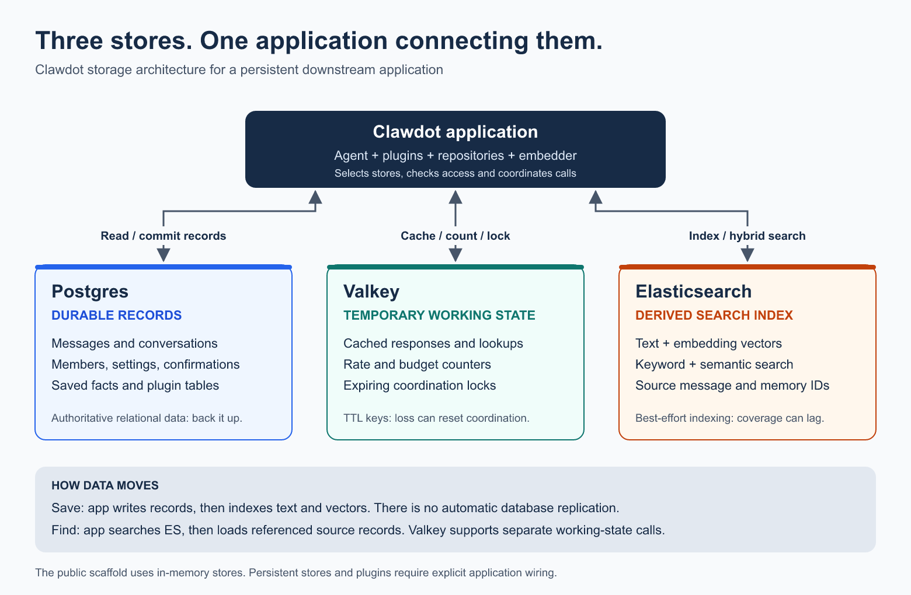

# Storage architecture

Clawdot applications can use three complementary services: **Postgres** stores
durable records, **Valkey** holds temporary cache and coordination state, and
**Elasticsearch (ES)** finds relevant text using keyword and vector search.

| Piece | Job | Example |
| --- | --- | --- |
| Postgres | Authoritative relational records | Messages, conversation turns, saved facts and plugin tables |
| Valkey | Expiring working state | Cached responses, request counters and locks |
| Elasticsearch | Derived search documents | Text, embeddings and references to source messages/facts |

The application connects to all three; they do not automatically synchronize.
Messages are saved before the search plugin schedules background indexing. A history
search uses ES to find candidates, then loads referenced messages from the repository.
Valkey serves separate caching and coordination operations along the way.

The public scaffold uses in-memory stores. Persistent downstream applications must
wire their chosen stores and plugins. ES indexing is best effort, with no durable
replay queue or general `/reindex` command in the current public platform. History
search can fall back to Postgres substring matching on an ES/embedder failure; cache
fallback needs explicit wiring and does not preserve distributed lock/counter state.

Read the [full storage guide](https://github.com/keenlok/clawdot-platform/blob/main/docs/storage-architecture.md)
for message and search flow diagrams, long-term memory, configuration, isolation,
outage behavior, recovery limits and implementation references.

The guide and [editable overview image](https://github.com/keenlok/clawdot-platform/blob/main/docs/images/storage-architecture.svg)
are maintained in the public repository. Update this overview when their meaning changes.
